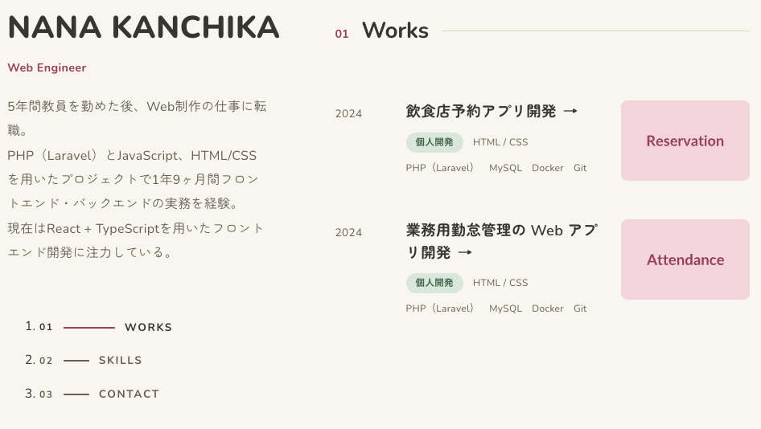

# Portfolio

Web エンジニア NANA KANCHIKA のポートフォリオサイトです。
これまでの制作実績・スキル・連絡先をまとめています。

**サイト URL：** https://nana-kanchika.netlify.app



## 使用技術

| 分類 | 技術 |
| --- | --- |
| フロントエンド | React 19 / TypeScript / Vite |
| ルーティング | React Router（Data Router：loader によるデータ取得） |
| スタイル | CSS Modules |
| UI | Swiper（実績詳細の画像スライダー） |
| CMS | microCMS（ヘッドレス CMS） |
| ホスティング | Netlify |
| 開発環境 | Docker（Node.js 24） / ESLint |

## 制作の目的

- 実務で担当した案件と個人開発の作品を、技術スタック・担当工程・チーム規模まで含めて具体的に伝えるため
- 実務では PHP（Laravel）を中心に経験してきたため、React + TypeScript でゼロから設計・実装し、フロントエンドの技術を実践的に身につけるため

## 技術選定の理由

- **React + TypeScript**
  - 実績カード・タグ・画像スライダーなど、同じ見た目を繰り返し使う UI が多いため、コンポーネント単位で組み立てられる React を選びました。`components/` を `layout` / `sections` / `ui` に分け、役割ごとに再利用しやすい構成にしています。
  - 実績・スキル・プロフィールの型を `src/types/index.ts` に定義し、microCMS のフィールド構成と対応させています。これにより、CMS 側の項目名を変えた際やモックデータに抜けがある場合も、実行前にコンパイルエラーとして気づけます。
  - 実務では PHP（Laravel）が中心だったため、現在のフロントエンド開発で標準的な構成を一から実装して身につける目的もあります。
- **Vite**
  - 開発サーバーの起動や HMR（保存時の即時反映）が速く、CSS や UI の細かい調整を繰り返す作業に向いているため。
  - 今回は SEO や SSR を必要としない SPA のため、Next.js のようなフレームワークは使わず、ビルドツールとして Vite を採用しました。TypeScript・CSS Modules・環境変数（`VITE_` 接頭辞）を追加設定なしで扱え、`vite.config.ts` もほぼ初期状態のまま運用できています。
- **microCMS**
  - 実績を追加・更新するたびにコードを修正・デプロイしなくて済むよう、コンテンツをコードから切り離すために採用しました。管理画面から更新するだけでサイトに反映されます。
  - API の構成（`works` / `skills` をリスト形式、`profile` をオブジェクト形式）をそのまま型定義に対応させられ、REST API なので SDK を使わず `fetch` だけで取得できます。
  - 無料プランで個人のポートフォリオには十分な規模を扱えること、管理画面が日本語で扱いやすいことも理由の一つです。
- **Netlify**
  - GitHub と連携して push するだけでビルドとデプロイが自動で行われるため、更新の手間を最小限にできます。
  - SPA でリロード時に 404 になる問題を、`public/_redirects` の1ファイルで解決できます。
  - microCMS の API キーなどの環境変数を管理画面から設定でき、リポジトリに秘密情報を含めずにビルドできる点も採用理由です。

## 工夫した点

### データソースの切り替え（microCMS ／ モックデータ）
環境変数が設定されていれば microCMS から、未設定ならローカルのモックデータ（`src/data/mock.ts`）からデータを取得します。データ取得は `src/lib/api.ts` にまとめ、画面側はデータの取得元を意識しない作りにしています。そのため、CMS を契約していない環境でも clone してすぐに動かせます。

### API キーの扱い
Vite では `VITE_` から始まる環境変数がビルド後の JS に埋め込まれ、ブラウザから誰でも見られます。この前提で、microCMS には **GET 権限のみの API キー** を発行して使っています。`.env` は git 管理外にし、`.env.example` で必要な項目だけを共有しています。

### SPA のリロード時 404 対策
クライアントサイドルーティングでは、`/works/xxx` を直接開いたりリロードしたりすると、サーバー側にそのファイルが無いため 404 になります。`public/_redirects` ですべてのパスを `index.html` に返すことで、この問題を回避しています。

### loader によるデータ取得とエラーハンドリング
React Router の `loader` で画面の表示前にデータを取得し、`useEffect` 内での fetch によるちらつきやローディング状態の管理を不要にしています。存在しない実績 ID や未定義のパスは `Response` を throw して 404 扱いにし、`errorElement` で共通のエラー画面を表示します。

### ナビゲーションの現在地表示
`IntersectionObserver` で「画面の上から 40〜50% の帯」に入ったセクションを検知し、サイドバーの現在地をハイライトしています（`src/hooks/useActiveSection.ts`）。scroll イベントを使わないため、スクロール中の負荷を抑えられます。

### 経験年数・制作期間の自動計算
スキルの開始月や案件の期間は `YYYY-MM` 形式で持たせ、表示時に「1年3ヶ月」のような表記に変換しています（`src/utils/period.ts`）。年数の手動更新が不要です。

## ディレクトリ構成

```
src/
├── components/
│   ├── layout/     # RootLayout・Sidebar・Footer
│   ├── sections/   # トップページの各セクション（Works / Skills / Contact）
│   └── ui/         # 汎用 UI（SectionTitle・WorkTag・ImageSlider）
├── pages/          # ページコンポーネントと loader（Top / WorkDetail / Error）
├── hooks/          # カスタムフック（useActiveSection）
├── lib/            # データ取得（microCMS ／ モックの切り替え）
├── data/           # モックデータ
├── types/          # 型定義（microCMS のフィールド構成と対応）
├── utils/          # 期間計算などのユーティリティ
├── styles/         # グローバル CSS
└── router.tsx      # ルーティング定義
```

## 開発

```sh
npm install
npm run dev        # http://localhost:5173
```

Docker で動かす場合：

```sh
docker compose up
```

## データ

- 既定では `src/data/mock.ts` のモックデータを表示します
- `.env.example` を `.env` にコピーして microCMS の値を入れると、microCMS から取得します
  - API：`works`（リスト）、`skills`（リスト）、`profile`（オブジェクト）
  - フィールド構成は `src/types/index.ts` を参照
- 実務案件のデータは公開範囲の確認が取れるまで `src/data/works.private.ts`（git 管理外）に分けています。このファイルが無い場合は、個人開発の作品だけが表示されます

## デプロイ（Netlify）

- Build command：`npm run build` ／ Publish directory：`dist`
- `public/_redirects` で SPA のリロード時 404 を回避しています
